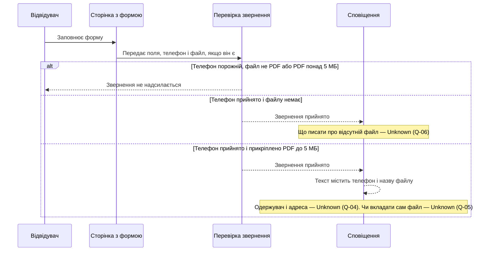

# Контактна форма: телефон, файл і сповіщення

Специфікація для [GitHub Issue #2](https://github.com/hoholkristina-dev/sdd-workshop-khrystyna/issues/2).

Кожне твердження має один статус:

- **Grounded** — є в оригінальному запиті Issue #2 або в поточному коді.
- **Invented** — навчальне припущення. У коментарі до Issue воно позначене як не підтверджене справжнім замовником.
- **Unknown** — рішення немає. Відповідь не вигадується.

## 1. Короткий опис

Відвідувач має залишати номер телефону, коли надсилає звернення з контактної форми. Він також має могти прикріпити документ: резюме (CV) або портфоліо. Сповіщення про нове звернення має містити ці нові дані. Це **Grounded**: так сформульовано оригінальний запит в Issue #2.

Зараз форма цього не робить. Це теж **Grounded**, бо так працює код:

- Номер телефону можна не заповнювати.
- Прикріпити файл не можна.
- Сторінка контактів показує ту саму форму, що й сторінка співпраці, і надсилає дані на адресу сервера `/api/collaboration` (API: адреса, на яку сторінка передає заповнену форму).
- Та сама форма стоїть у вікні запиту нот, але введені дані нікуди не надсилаються.
- Жоден маршрут форми не створює сповіщення і не зберігає звернення.

У коментарі до Issue з критеріями приймання форму звужено до одного PDF-файлу (PDF: файл документа) розміром до 5 МБ. В оригінальному запиті формату і розміру немає, тому це обмеження лишається **Unknown**. Критерії AC-04–AC-07 нижче повторюють текст цього коментаря і не закривають відкриті питання.

## 2. User story

Як відвідувач сайту, я хочу надіслати звернення з номером телефону і за потреби з одним PDF-файлом до 5 МБ, щоб сповіщення про це звернення містило телефон і назву прикріпленого файлу.

Частина про обов’язковий телефон і сповіщення з новими даними — **Grounded**. Частина «один PDF до 5 МБ» і «назва файлу» взята з коментаря з критеріями приймання; в оригінальному запиті її немає, деталі лишаються **Unknown** (Q-05, Q-07, Q-08, Q-09).

## 3. Діаграма потоку

Діаграма показує цільовий потік за критеріями приймання, а не поточну поведінку сайту. Хто отримує сповіщення, куди потрапляє файл і що писати про файл, якщо його немає, на діаграмі не вирішено.

## 4. Таблиця правил

| ID | Правило простою мовою | Статус |
|---|---|---|
| BR-01 | Номер телефону є обов’язковим для надсилання контактної форми. | Grounded |
| BR-02 | Відвідувач може прикріпити до форми документ: CV або портфоліо. | Grounded |
| BR-03 | Сповіщення про нове звернення містить інформацію про номер телефону та прикріплений файл. | Grounded |
| BR-04 | Якщо файл прикріплено, це один PDF розміром до 5 МБ. Інакше звернення не надсилається. Без файлу звернення надіслати можна. | Unknown |
| BR-05 | Частка надісланих звернень із телефоном і частка звернень із файлом показують успіх зміни. Числової цілі немає. | Invented |
| NFR-01 | Телефон і файл бачить лише координатор звернень Фонду. | Invented |
| NFR-02 | Телефон зберігається, поки звернення в роботі, і ще 12 місяців після закриття. | Invented |
| NFR-03 | CV або портфоліо зберігається 6 місяців після закриття звернення, потім видаляється. | Invented |

BR-04 записане в критеріях приймання коментаря до Issue, але оригінальний запит не називає ні PDF, ні 5 МБ. Тому правило не переведене в Grounded. NFR-01–NFR-03 і BR-05 не є рішенням для розробки, доки замовник їх не підтвердить.

## 5. Критерії приймання

### AC-01

- **Given** відвідувач заповнив обов’язкові поля та вказав правильний номер телефону
- **When** він надсилає форму
- **Then** звернення приймається

### AC-02

- **Given** відвідувач заповнив решту полів, але залишив телефон порожнім
- **When** він намагається надіслати форму
- **Then** звернення не надсилається

### AC-03

- **Given** відвідувач заповнив форму з правильним телефоном і не прикріпив файл
- **When** він надсилає форму
- **Then** звернення приймається

### AC-04

- **Given** відвідувач заповнив форму з правильним телефоном і прикріпив один PDF розміром до 5 МБ
- **When** він надсилає форму
- **Then** звернення приймається

### AC-05

- **Given** відвідувач прикріпив файл не у форматі PDF
- **When** він намагається надіслати форму
- **Then** звернення не надсилається

### AC-06

- **Given** відвідувач прикріпив PDF розміром понад 5 МБ
- **When** він намагається надіслати форму
- **Then** звернення не надсилається

### AC-07

- **Given** звернення прийнято з правильним телефоном і прикріпленим PDF
- **When** система формує сповіщення
- **Then** сповіщення містить номер телефону і назву прикріпленого файлу

## 6. Таблиця ключових файлів

| Файл | Навіщо він формі | Що змінювати | Статус поточного коду |
|---|---|---|---|
| `app/shared/components/forms/contact-form/ContactForm.tsx` | Поля форми і перевірка на сторінці. | Зробити телефон обов’язковим і додати необов’язковий файл. | Grounded: телефон необов’язковий, поля файлу немає. |
| `app/shared/components/forms/offer-collaboration-form/OfferCollaborationForm.tsx` | Надсилає форму контактів і співпраці. | Передати файл разом з полями. Зараз дані йдуть як JSON (текстовий пакет без файлу). | Grounded: запит іде на `/api/collaboration`. |
| `app/[lang]/contacts/ContactsInfo/ContactsInfo.tsx` | Сторінка контактів. | Окремої логіки немає: сторінка показує спільну форму. | Grounded |
| `app/shared/components/blocks/partnership-formats/PartnershipFormats.tsx` | Блок співпраці з тією самою формою. | Чи потрібен тут файл — Unknown (Q-02). | Grounded: форма та сама. |
| `app/shared/components/get-notes-modal/GetNotesModal.tsx` | Вікно запиту нот. | Чи діятимуть нові правила тут — Unknown (Q-02). | Grounded: дані форми нікуди не надсилаються. |
| `app/lib/utils/validateContactData.ts` | Перевірка на сервері. | Відхиляти порожній телефон і файл, який не проходить правила файлу. | Grounded: порожній телефон зараз дозволений. |
| `app/constants/validation.ts`, `app/constants/errors.ts` | Довжина телефону, шаблон і тексти помилок. | Додати помилки для обов’язкового телефону і файлу, коли правила буде вирішено. | Grounded: для телефону є шаблон «плюс і цифри», довжина від 11 до 16. Правил файлу немає. |
| `app/api/collaboration/route.ts` | Маршрут, який реально викликає сторінка контактів. | Приймати файл і перевіряти його. Зараз повертає успіх у демо-режимі. | Grounded: сповіщення не надсилає і звернення не зберігає. |
| `app/api/contact/route.ts` | Другий маршрут із тією самою перевіркою. | Чи змінювати його разом із першим — Unknown (Q-03). | Grounded: сторінки його не викликають. |
| `app/services/email/emails/emails.ts` | Текст листа для контактної форми і для співпраці. | Додати телефон і назву файлу, коли буде вирішено склад сповіщення. | Grounded: телефон у текст потрапляє лише якщо його передали. Назви файлу немає. |
| `app/services/email/emailService.ts` | Служба листів. | Підключити її до маршруту форми лише після відповіді, кому писати. | Grounded: маршрути її не викликають. Адреси отримувача в методі контактного листа немає. |
| `app/services/upload/upload.ts` | Демо-сховище файлів. | Місце для файлу звернення не визначене (Q-10). | Grounded: метод завантаження не приймає файл. |
| `i18n/messages/uk.json`, `i18n/messages/en.json` | Тексти українською та англійською (i18n: переклади інтерфейсу). | Додати підпис телефону як обов’язкового поля і тексти про файл. | Grounded: підпис телефону є, текстів про файл немає. |
| `app/infrastructure/models/foundation-info/foundationInfoContact.ts` | Публічний телефон і пошта Фонду на сайті. | Не використовувати як сховище звернень. | Grounded: це не дані форми. |

Поруч є тести цих файлів: `ContactForm.test.tsx`, `validateContactData.test.ts`, `app/api/collaboration/route.test.ts`, `app/api/contact/route.test.ts`, `emails.test.ts`, `emailServise.test.ts`, `upload.test.ts`. Зараз вони фіксують стару поведінку: форму можна надіслати без телефону, а маршрут співпраці не надсилає лист.

## 7. Відкриті питання

**Q-01.** Який номер телефону вважати правильним?

**Grounded:** на сторінці телефон перевіряє маска введення, а на сервері — рядок, що починається з `+` і містить лише цифри, довжиною від 11 до 16 символів. Яке з цих правил залишити, не вирішено.

**Q-02.** Чи діють ці правила також для форми співпраці та вікна запиту нот?

**Grounded:** усі три місця показують один і той самий компонент форми.

**Q-03.** Чи обидва API-маршрути мають перевіряти телефон і файл?

**Grounded:** сторінка контактів викликає лише `/api/collaboration`. Маршрут `/api/contact` існує і використовує ту саму перевірку, але викликів з сторінок у коді немає.

**Q-04.** Хто отримує сповіщення і на яку адресу?

**Grounded:** маршрути форми лист не надсилають. Адреси отримувача в коді контактної форми немає.

**Invented, не є відповіддю:** раніше припускалося, що лист іде координатору звернень на службову пошту. Справжній замовник це не підтвердив.

**Q-05.** Сповіщення має містити сам файл чи лише його назву?

**Grounded:** AC-07 називає номер телефону і назву файлу. Оригінальний запит каже лише, що сповіщення має містити нові дані.

**Q-06.** Що показувати у сповіщенні, якщо файлу немає?

**Q-07.** PDF перевіряється за розширенням, MIME-типом (позначка типу файлу, яку передає браузер) чи обома умовами?

**Grounded:** у формі такої перевірки немає. Окремий список типів для інших файлів сайту дозволяє PDF разом із зображеннями, текстом, звуком і відео. Цей список до контактної форми не підключений.

**Q-08.** Що саме означає межа 5 МБ?

**Grounded:** у коді й в оригінальному запиті межі 5 МБ немає. Не вирішено, чи розмір рівно 5 МБ приймається і чи це десяткові мегабайти, чи мебібайти.

**Q-09.** Чи можна прикріпити лише один файл?

**Grounded:** у AC-04 сказано «один PDF». Оригінальний запит говорить про документ CV або портфоліо і не каже, скільки файлів можна додати.

**Q-10.** Де і скільки часу зберігати файл?

**Grounded:** моделі збереженого звернення немає. Демо-сховище файлів не приймає файл форми.

**Invented, не є відповіддю:** у навчальному припущенні файл видаляють через 6 місяців після закриття, а телефон зберігають ще 12 місяців. Справжній замовник це не підтвердив.

## 8. Посилання

[GitHub Issue #2. Contact form — update validation and notifications](https://github.com/hoholkristina-dev/sdd-workshop-khrystyna/issues/2)
